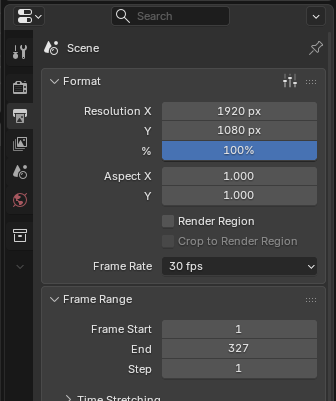
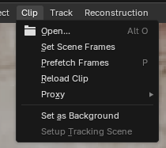
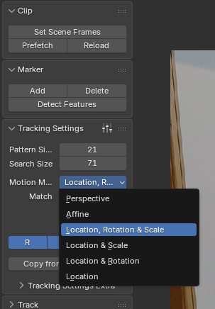
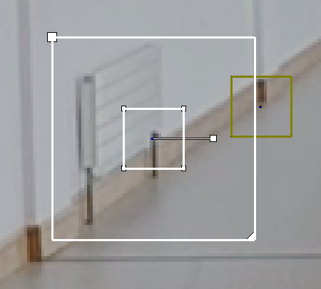
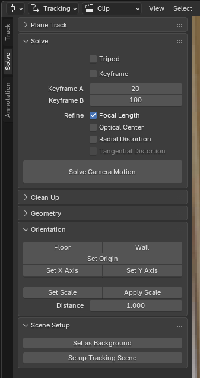
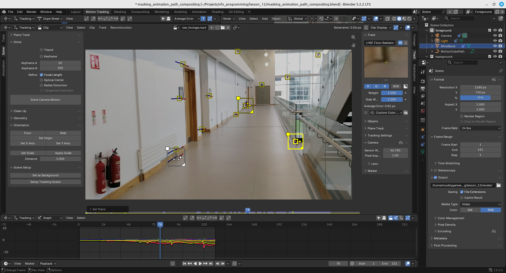
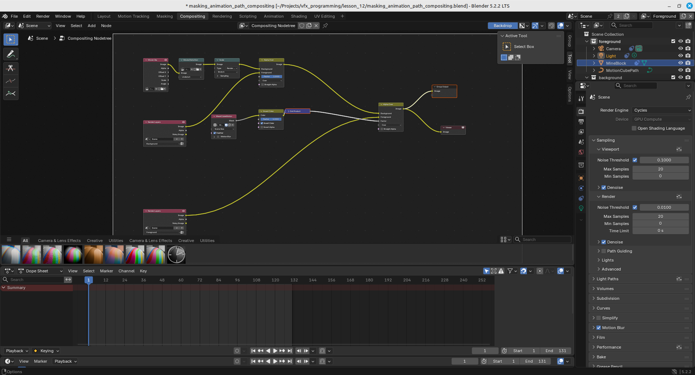
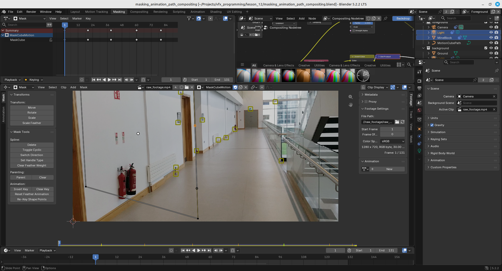
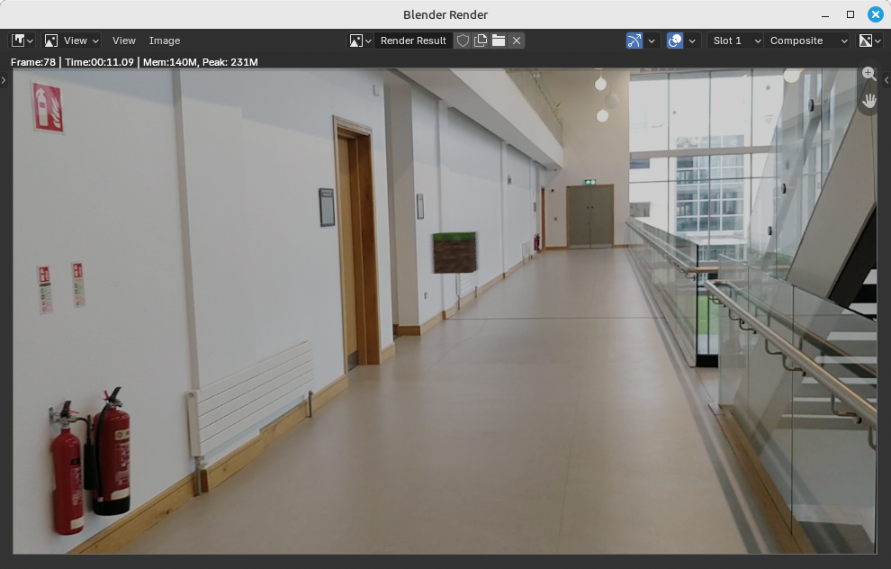

# Blender Motion Tracking Guide

Blender camera tracking: placing 3D objects into real-world footage and fixing mesh sliding.

**13 steps, from importing footage to final compositing.**

## Contents

1. [Import Your Footage](#step-1-import-your-footage)
2. [Add Tracking Markers](#step-2-add-tracking-markers)
3. [Track Your Markers](#step-3-track-your-markers)
4. [Clean Up Your Tracking Data](#step-4-clean-up-your-tracking-data)
5. [Solve Camera Motion](#step-5-solve-camera-motion)
6. [Set the Floor, Origin and Scene Scale](#step-6-set-the-floor-origin-and-scene-scale)
7. [Set Up the Tracking Scene](#step-7-set-up-the-tracking-scene)
8. [Add and Position Your 3D Mesh](#step-8-add-and-position-your-3d-mesh)
9. [Fix Mesh Sliding: Add More Tracking Markers](#step-9-fix-mesh-sliding-add-more-tracking-markers)
10. [Check Mesh Depth and Placement](#step-10-check-mesh-depth-and-placement)
11. [Check Focal Length and Tracking Accuracy](#step-11-check-focal-length-and-tracking-accuracy)
12. [Check Tracking Stability Throughout the Footage](#step-12-check-tracking-stability-throughout-the-footage)
13. [Final Compositing and Rendering](#step-13-final-compositing-and-rendering)

---

## Step 1: Import Your Footage

**Goal:** Prepare your footage for motion tracking.

1. Open Blender.
2. Select the **Motion Tracking** workspace.
3. Open the **Movie Clip Editor**.
4. Click **Open** and load your video.

<!-- IMAGE: images/motion_tracking/open_movie_clip.png -->

5. Match the scene frame rate to your footage in **Output Properties -> Format -> Frame Rate**.

6. Set the correct frame range. In the Movie Clip Editor sidebar (`N`), open the **Footage Settings** panel and click **Set Scene Frames**. This sets the scene's start and end frames to match the clip's length.

   Check the result under **Output Properties -> Frame Range**.

7. Prefetch the footage. With your mouse over the Movie Clip Editor, press `P` (or use **Clip -> Prefetch Frames**). This loads the frames into memory, so playback runs at full speed and tracking is faster.

> 💡 **Tip:** If Blender can't hold the whole clip in memory, raise the limit in **Edit -> Preferences -> System -> Memory Cache Limit**. Long or high-resolution clips need more memory.

### Keyboard shortcuts

| Shortcut | Action |
|---|---|
| `Alt + O` | Open clip (where supported) |
| `P` | Prefetch frames into memory |
| `Space` | Play / pause |
| `Left` / `Right Arrow` | Previous / next frame |
| `Shift + Left Arrow` | First frame |
| `Shift + Right Arrow` | Last frame |

> 💡 **Tip:** Use footage with minimal motion blur and plenty of visible environmental detail.

---

## Step 2: Add Tracking Markers

**Goal:** Give Blender points to follow throughout the footage.

### Choose a motion model first

Before you add markers, open the **Tracking Settings** panel in the Movie Clip Editor's toolbar (`T`) and pick a **Motion Model**. New markers use this setting, and it tells Blender how a feature is allowed to change from frame to frame.

| Motion model | Use when |
|---|---|
| **Loc** | The feature only moves across the frame. This is the simplest and most stable option. |
| **LocScale** | The camera moves towards or away from the feature, so it grows or shrinks. |
| **LocRot** | The feature rotates in the frame, for example when the camera rolls. |
| **LocRotScale** | The feature moves, rotates and changes size. |
| **Affine** | The feature also skews as the viewing angle changes. |
| **Perspective** | The feature sits on a flat surface seen at a changing angle, such as the floor. This is the most flexible option and the most likely to drift. |

> 💡 **Tip:** Start with **Loc** or **LocScale**. Only move to a more complex model if markers slip because the feature changes shape. More freedom means more ways for a track to wander.

### Place the markers

1. Find clearly visible details in your footage.
2. Place your mouse over a feature.
3. Press `Ctrl + Left Click` to add a tracking marker.
4. Position it accurately over the feature.
5. Start with approximately **8 to 15** reliable markers.
6. Distribute markers across the foreground, middle ground and background.
7. Include markers near the surface where your 3D mesh will sit.

<!-- IMAGE: images/motion_tracking/adding_tracking_markers.png -->

### Good tracking points

- Building corners
- Pavement cracks
- Floor patterns
- Window corners
- Static furniture

### Keyboard shortcuts

| Shortcut | Action |
|---|---|
| `Ctrl + Left Click` | Add marker |
| `X` | Delete selected marker |

> 💡 **Tip:** Track stationary environmental features, **not** moving people or vehicles.

---

## Step 3: Track Your Markers

**Goal:** Follow the selected features throughout the video.

1. Select your tracking markers.
2. Press `Ctrl + T` to track forwards.
3. Let Blender track through the footage.
4. Inspect the markers as they move.
5. Stop when a marker starts slipping.
6. Correct the marker or remove it if necessary.
7. Track backwards where required.

<!-- IMAGE: images/motion_tracking/tracking_markers.png -->

### Tracking forwards and backwards

A marker only gets tracked from the frame where you placed it, in the direction you choose. A marker placed halfway through the clip and tracked only forwards has **no data for the first half**.

- **Track forwards** (`Ctrl + T`) follows the feature from the current frame towards the end of the clip.
- **Track backwards** (`Ctrl + Shift + T`) follows it from the current frame towards the start.
- For a feature that is visible across the whole clip, place the marker on a frame in the **middle** of the clip where the feature is sharp. Track forwards, return to that frame, then track backwards.
- For a feature that only appears partway through (it comes into view or is uncovered), place the marker on the first clear frame and track forwards. For one that leaves the frame, place it on the last clear frame and track backwards.
- If a track fails, step **one frame at a time** with `Alt + Right Arrow` / `Alt + Left Arrow`. Watch the marker, nudge it back onto the feature with `G` when it slips, then carry on.

> 💡 **Tip:** Tracking stops automatically when Blender loses the feature, and the marker is disabled from that frame on. That's the frame to inspect.

### Locking a tracker

Once a track is finished and you're happy with it, **lock it** so you can't accidentally move or retrack it while you work on other markers.

| Shortcut | Action |
|---|---|
| `Ctrl + L` | Lock selected tracks |
| `Ctrl + Alt + L` | Unlock selected tracks |

You can also toggle the padlock icon in the **Track** panel of the sidebar (`N`). Locked tracks still take part in the camera solve. They just can't be edited.

> ⚠️ **Note:** Don't confuse this with **Lock to Selection** (`L`) in the editor header. That option keeps the view centred on the selected marker during playback, which is very handy for inspecting a track, but it doesn't protect the track.

### Showing the search area (`Alt + S`)

Each marker has two boxes:

- **Pattern area** (the inner box): the patch of image Blender looks for.
- **Search area** (the outer box): how far Blender is allowed to look for that patch in the next frame.

The search area is hidden by default. Press `Alt + S` to toggle it on and off. It's also under **Clip Display -> Marker Display -> Search** in the editor header.

In this screenshot:

- The **small inner box** is the pattern area, placed on a distinctive detail.
- The **large outer box** is the search area. Drag its corner handle to resize it, or drag its top-left square to move it.
- The **yellow box** on the right is another marker that isn't selected, so only its pattern area is shown.

Once it's visible you can drag its corners to resize it. This matters because:

- If the feature moves **further between frames than the search area allows** (fast camera moves, whip pans, low frame rates), the track will jump or fail. Make the search area bigger.
- If the search area is **too big**, Blender may lock onto a similar-looking feature nearby, and tracking slows down. Keep it only as big as the motion needs.

### More tips for good tracks

- **Pattern size:** Make the pattern area big enough to hold a distinctive, high-contrast detail, such as a corner rather than a flat wall. Too small and it's easy to confuse with something else. Too big and it may include parts of the image that move differently.
- **Prefer corners to edges:** A marker on a straight edge can slide along that edge without Blender noticing. Corners and "X" or "L" shaped details pin the marker in both directions.
- **Avoid reflections, shadows and anything that changes:** Reflections in glass, moving shadows, flickering lights and water all move independently of the camera.
- **Watch the edges of the frame:** Features near the image edges are more affected by lens distortion and leave the frame first. Use them, but check them carefully.
- **Use Lock to Selection while inspecting:** Press `L`, then play the clip. If the feature wobbles in the centre of the view, the track is drifting.
- **Matching setting:** In **Tracking Settings**, **Keyframe** matching compares each frame to the frame where the marker was placed. This is more stable and resists drift. **Previous Frame** compares to the frame before, which handles features that slowly change appearance but can drift over long shots.
- **Normalize:** Enable **Normalize** in Tracking Settings when the lighting changes during the shot, such as clouds passing or auto-exposure.
- **Hide finished tracks:** Press `H` to hide selected tracks and `Alt + H` to show them all again. This keeps the view uncluttered while you work on new ones.

### Keyboard shortcuts

| Shortcut | Action |
|---|---|
| `Ctrl + T` | Track forwards (to the end) |
| `Ctrl + Shift + T` | Track backwards (to the start) |
| `Alt + Right Arrow` | Track forwards one frame |
| `Alt + Left Arrow` | Track backwards one frame |
| `Ctrl + L` | Lock selected tracks |
| `Ctrl + Alt + L` | Unlock selected tracks |
| `Alt + S` | Show / hide the search area |
| `L` | Lock view to selection |
| `G` | Move marker (to correct a slip) |
| `H` / `Alt + H` | Hide selected tracks / show all |

> ⚠️ **Important:** Don't assume a track is good just because Blender successfully tracked it. Make sure it stays attached to its original feature.

---

## Step 4: Clean Up Your Tracking Data

**Goal:** Remove inaccurate tracking information before solving the camera.

1. Scrub through the footage.
2. Identify markers drifting away from their original features.
3. Check markers that become obscured.
4. Look for markers following moving objects.
5. Correct inaccurate tracks.
6. Delete unreliable markers.
7. Check that your remaining markers are distributed across the image.

<!-- IMAGE: images/motion_tracking/cleaning_tracking_data.png -->

> 💡 **Tip:** A smaller number of accurate tracks is better than a large number of inaccurate tracks.
>
> 💡 **Tip:** Bad tracking data can harm your camera solve and contribute to problems such as mesh sliding.

---

## Step 5: Solve Camera Motion

**Goal:** Reconstruct the movement of your real camera in 3D space.

1. Open the **Solve** panel.
2. Check the camera's focal length.
3. Set appropriate **Keyframe A** and **Keyframe B** positions.
4. Enable **Refine Focal Length** if necessary.
5. Click **Solve Camera Motion**.
6. Wait for Blender to calculate the camera movement.
7. Review the **Average Solve Error**.

> 💡 **Tip:** A lower solve error is generally better, but it doesn't guarantee that your mesh will stay perfectly attached to the real-world surface.
>
> 💡 **Tip:** Don't ignore poor tracking markers just to get a lower error. It's a balance between a low error, the number of markers and the quality of the camera solve.

---

## Step 6: Set the Floor, Origin and Scene Scale

**Goal:** Establish the correct orientation and scale of your reconstructed environment.

1. Select three tracking points on the same flat surface.
2. Open the **Solve** panel.
3. Click **Set Floor**.
4. Select a tracking marker where you want the scene origin.
5. Click **Set Origin**.
6. Select two points with a known real-world distance.
7. Click **Set Scale**.
8. Enter the actual distance.

> ⚠️ **Important:** Your floor markers must be on the same physical plane. Don't mix points from the floor and walls. This step is particularly important when placing a mesh on a real-world surface; otherwise it will hop or jitter.

---

## Step 7: Set Up the Tracking Scene

**Goal:** Create the 3D camera and background setup.

1. Open the **Scene Setup** panel.
2. Click **Setup Tracking Scene**.
3. Switch to the **3D Viewport**.
4. Press `Numpad 0` to view through the tracked camera.
5. Inspect the reconstructed scene.
6. Confirm that the camera movement matches your original footage.

<!-- IMAGE: images/motion_tracking/setup_tracking_scene.png -->

Blender creates the camera and background setup needed for compositing.

---

## Step 8: Add and Position Your 3D Mesh

**Goal:** Place your 3D object into the reconstructed environment.

1. Move your cursor into the **3D Viewport**.
2. Press `Shift + A`.
3. Select the mesh you want to add.
4. Position it on the reconstructed surface.
5. Adjust its height.
6. Match its rotation to the real-world surface.
7. Adjust its scale.
8. Check its position through the tracked camera using `Numpad 0`.

<!-- IMAGE: images/motion_tracking/positioning_mesh.png -->

### Useful shortcuts

| Shortcut | Action |
|---|---|
| `Shift + A` | Add object |
| `G` | Move |
| `R` | Rotate |
| `S` | Scale |
| `Ctrl + A` | Apply transforms |
| `Numpad 0` | Camera view |
| `Numpad .` | Frame selected |

> 💡 **Important:** If your mesh is attached to a stationary surface, its position in the reconstructed 3D world should remain fixed.

---

## Step 9: Fix Mesh Sliding: Add More Tracking Markers

**Goal:** Improve the camera solve if too little or poorly distributed tracking data is causing sliding.

1. Find the exact frame where your mesh starts sliding.
2. Pause the footage.
3. Inspect your existing tracking markers.
4. Add new markers around the affected area.
5. Add more markers across the foreground and background.
6. Make sure they follow stationary real-world features.
7. Track the new markers forwards and backwards.
8. Inspect their accuracy.
9. Remove unreliable markers.
10. Solve the camera motion again.

<!-- IMAGE: images/motion_tracking/adding_more_markers.png -->

> 💡 **Recommendation:** Add reliable markers throughout the sequence, not just at the frame where sliding begins.

More accurate tracking data can improve the camera reconstruction. Adding more markers won't automatically fix every sliding problem, but it's a good start.

---

## Step 10: Check Mesh Depth and Placement

**Goal:** Make sure your mesh is positioned correctly in 3D space.

An incorrectly reconstructed depth can make your mesh appear to slide as the camera moves.

1. Select your mesh.
2. Inspect its position in the **3D Viewport**.
3. Check its distance from the tracked camera.
4. Confirm that its bottom aligns with the intended surface.
5. Check that the reconstructed floor is correctly oriented.
6. Adjust the mesh position if necessary.
7. Replay the footage to check the result.

<!-- IMAGE: images/motion_tracking/checking_mesh_depth.png -->

> 💡 **Tip:** If the mesh looks correct at first but drifts as the camera moves, investigate the camera solve and scene reconstruction before manually animating the mesh.

---

## Step 11: Check Focal Length and Tracking Accuracy

**Goal:** Identify camera settings and tracking errors that may contribute to sliding.

### Check focal length

1. Open the **Solve** panel.
2. Check your camera's focal length.
3. Enable **Refine Focal Length** if appropriate.
4. Solve the camera again.
5. Compare the results.

<!-- IMAGE: images/motion_tracking/focal_length_settings.png -->

### Check lens distortion

1. Inspect the original footage.
2. Look for curved lines near the image edges.
3. Check the camera distortion settings.
4. Refine distortion parameters if necessary.
5. Repeat the solve.

<!-- IMAGE: images/motion_tracking/lens_distortion_settings.png -->

### Check individual markers

1. Find the frame where sliding begins.
2. Inspect the tracking markers.
3. Look for markers that have slipped.
4. Correct their positions.
5. Remove unreliable tracks.
6. Solve again.

---

## Step 12: Check Tracking Stability Throughout the Footage

**Goal:** Confirm that your mesh stays attached to the intended surface.

**Don't judge your tracking from just one frame!** Check:

- [ ] The first frame
- [ ] The frame where sliding begins
- [ ] A frame in the middle
- [ ] The last frame
- [ ] The complete sequence, played back
- [ ] That the mesh remains attached to the intended surface

<!-- IMAGE: images/motion_tracking/checking_stability.png -->

### Additional techniques

- Adjust tracking weights where appropriate.
- Remove unreliable tracking markers.
- Check the tracking motion model (see [Step 2](#choose-a-motion-model-first)).
- Investigate camera distortion.
- Check your reconstructed floor and scene scale.

> 💡 **Tip:** Don't use manual keyframes to compensate for an inaccurate camera solve.

---

## Step 13: Final Compositing and Rendering

**Goal:** Finish the scene and produce the final result.

1. Add materials to your mesh.
2. Set up lighting that matches the original footage.
3. Add shadows where appropriate.
4. Check that the mesh has the correct scale.
5. Verify alignment throughout the footage.
6. Set up the **Compositor**.
7. Combine the rendered 3D scene with your original footage.
8. Mask any real objects that pass in front of the mesh (see [Masking](#masking-putting-real-objects-in-front-of-your-mesh)).
9. Check the final result.
10. Render your animation.

### Masking: putting real objects in front of your mesh

By default your 3D mesh is laid over the top of the whole frame. If something in the real footage should pass **in front** of the mesh (a person, a post or a table edge), the mesh will wrongly cover it. A **mask** cuts that area out so the original footage shows through.

**Draw the mask**

1. In the **Movie Clip Editor**, change the mode in the header from **Tracking** to **Mask**.
2. Click **New** to create a mask.
3. `Ctrl + Left Click` around the outline of the foreground object to add points. Click the first point to close the shape.
4. Drag a point's handles to curve the edge, and drag outwards on a point to **feather** (soften) the edge.

**Make the mask follow the footage**

- **Parent it to tracks:** select the mask points, then `Shift`-select a tracking marker on the same object. Press `Ctrl + P` and the mask moves with the track. This is the quickest option for rigid objects.
- **Animate it by hand:** for objects that change shape, move to a new frame, adjust the points and press `I` to insert a shape keyframe. Use as few keyframes as possible and check the in-between frames.

**Use it in the Compositor**

1. Add a **Mask** node (**Add -> Input -> Mask**) and select your mask.
2. Use its output to cut the mesh out where the foreground object is. For example, plug it into the **Factor** of a **Mix** node, or multiply it into the alpha of the render before the **Alpha Over** node.
3. Scrub through the footage and check that the mask edge lines up with the object on every frame.

> 💡 **Tip:** Make the mask slightly smaller than the object and add a little feather. A hard edge that sits a few pixels outside the object is far more noticeable than a soft one inside it.
>
> 💡 **Tip:** Masks can also help tracking. A mask can hide a moving object inside a marker's pattern area, so Blender only follows the static background. Use this when a good feature has something moving across it.

